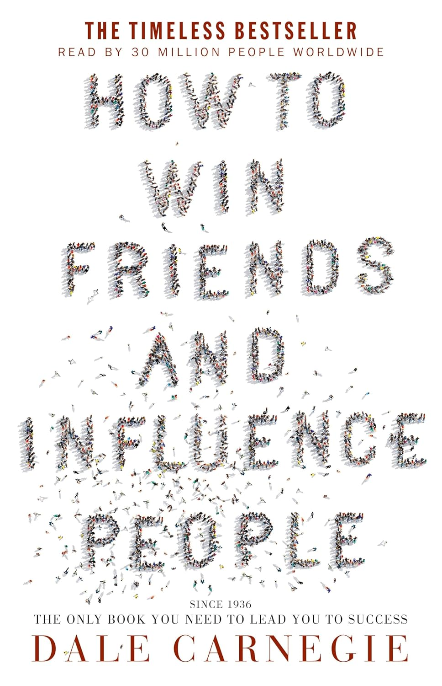

---    
date: 2026-11-09T06:56:52.077Z
title: "How to Win Friends and Influence People by Dale Carnegie"
description: "Through an assortment of case studies (which now feel a bit outdated), Carnegie drives home the age-old adage 'Treat others as you would like to treated'"
tags: ["bookshelf", "non-fiction", "people"]
featuredimage: './cover.jpg'
---   

For the longest time, I was hesitant to pick this book up despite its acclaim. The title felt disingenuous and gave me visions of villian honing their social manipulation techniques. 

To Carnegie's credit, it wasn't all that bad. 

In fact, it serves as a no-nonsense guide on dealing with people. 

People - i.e. you - are endlessly complicated, yet sometimes entirely predictable. Vain, yet self-aware at the same time. Like it or not, we're driven by feeling versus rational thought, and whilst the next bodhisattva might be able to hold their tongue at a critcising remark, most people would feel shame and anger. 

 

Through an assortment of case studies (which now feel a bit outdated), Carnegie drives home the age-old adage "Treat others as you would like to treated". 

As you read this book you find yourself subconciously nodding in agreement and talking aloud: "Why, of course that makes sense." 

The question stands, if it's so obvious, why don't we see this around us? *I'd argue that's one of our greatest collective tragedies.*

**Treat others with care and importance.**

Dual-wielded as an audiobook and physical book and finished in October 2026.

--- 

## Techniques in Handling People
- Don’t criticize, condemn, or complain.
- Give honest and sincere appreciation.
- Arouse in the other person an eager want.

## Six Ways to Make People Like You
- Become genuinely interested in other people.
- Smile.
- Remember that a person’s name is to that person the sweetest and most important sound in any language.
- Be a good listener. Encourage others to talk about themselves.
- Talk in terms of the other person’s interests.
- Make the other person feel important – and do it sincerely.

## Win People to Your Way of Thinking
- The only way to get the best out of an argument is to avoid it.
- Show respect for the other person’s opinions. Never say, “You’re wrong.”
- If you are wrong, admit it quickly and emphatically.
- Begin in a friendly way.
- Get the other person saying “yes, yes” immediately.
- Let the other person do a great deal of the talking.
- Let the other person feel that the idea is his or hers.
- Try honestly to see things from the other person’s point of view.
- Be sympathetic to the other person’s ideas and desires.
- Appeal to the nobler motives.
- Dramatize your ideas.
- Throw down a challenge.

## Be a Leader: How to Change People Without Giving Offense or Arousing Resentment
- Begin with praise and honest appreciation.
- Call attention to people’s mistakes indirectly.
- Talk about your own mistakes before criticizing the other person.
- Ask questions instead of giving direct orders.
- Let the other person save face.
- Praise the slightest improvement and praise every improvement. Be “hearty in your approbation and lavish in your praise.”
- Give the other person a fine reputation to live up to.
- Use encouragement. Make the fault seem easy to correct.
- Make the other person happy about doing the thing you suggest.

